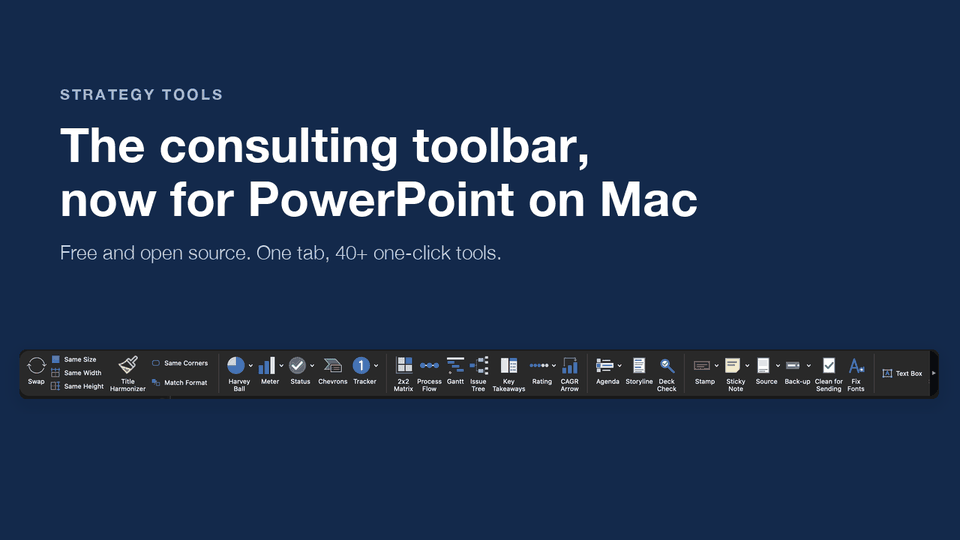
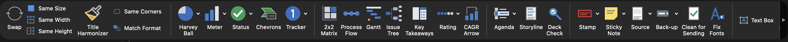
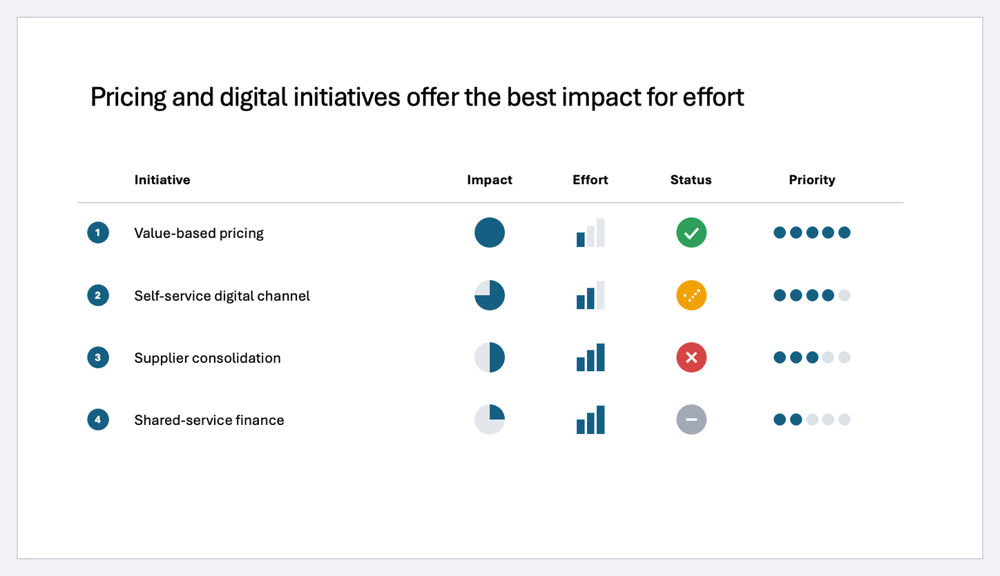
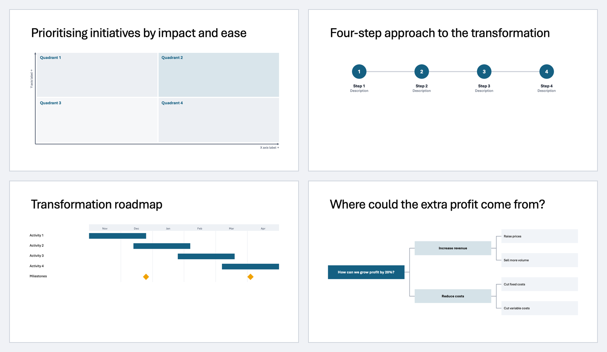
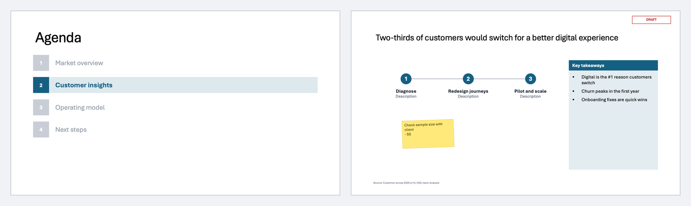

# Strategy Tools: PowerPoint Add-in for Mac

A free PowerPoint add-in with the toolkit strategy consultants rely on, the kind of thing large consulting firms build into their in-house toolbars. It adds a **Strategy Tools** tab to the PowerPoint ribbon with:

- **Format:** swap objects, match size/width/height to the first object clicked, harmonise titles, match corners and formatting
- **Visuals:** Harvey balls, meters, status icons, chevrons, numbered trackers
- **Frameworks:** 2×2 matrix, process flow, Gantt, issue tree, key takeaways panel, rating scale, CAGR arrow
- **Storyline:** agenda with highlighted dividers and section tags, storyline overview, deck check report
- **Review:** status stamps, sticky notes, source footers, back-up labels, clean-for-sending copy, font fixer
- **Keyboard shortcuts:** new text box, align left/right/top/bottom, and a searchable shortcuts cheat sheet

Built for **PowerPoint for Mac** (Microsoft 365 or Office 2019 and later). Windows isn't supported.




*The Strategy Tools tab: Format, Visuals, Frameworks, Storyline, Review and Help groups.*

### ⬇️ [Download Strategy Tools for Mac (StrategyTools.zip)](https://github.com/sayantan92sanyal/strategy-tools-powerpoint/releases/latest/download/StrategyTools.zip)

Unzip it, double-click **Install Strategy Tools.command** and follow the [install steps](#install). Takes about 3 minutes.

> **Work laptop?** Strategy Tools is a macro add-in. Many company-managed Macs block macros; if PowerPoint never offers **Enable Macros**, the add-in can't run on that Mac.

**Want to build your own version, or add features with AI?** See [Build it with Claude Code](docs/BUILD-WITH-CLAUDE-CODE.md).

---

## Features

### Format
| Button | How to use it |
|---|---|
| **Swap** | Select exactly 2 objects. They trade places (by their centres) and keep their own sizes. |
| **Same Size** | Select 2+ objects. All of them take the width and height of the **first object you clicked**. |
| **Same Width** | As above, width only. |
| **Same Height** | As above, height only. |
| **Title Harmonizer** | Click into a slide title. Every other slide's title gets the same font and font size. Slides with a *Title Slide* layout are skipped. |
| **Same Corners** | Select 2+ rounded shapes. All get the first one's corner rounding (in points), so small and large boxes look identical. |
| **Match Format** | Select 2+ objects. Fill, outline, shadow, font and text colour are copied from the first one clicked. Sizes and positions stay. |

### Visuals

*An initiative tracker built entirely from one-click visuals: trackers, Harvey balls, meters, status icons and ratings.*

| Button | How to use it |
|---|---|
| **Harvey Ball ▾** | Pick 0%, 25%, 50%, 75% or 100%. A Harvey ball appears in the middle of the slide. To change an existing one, select it and pick a new level. |
| **Meter ▾** | Pick Low, Medium or High. A 3-bar rising meter appears. Select existing meters to change them. |
| **Status ▾** | Complete (green circle, white tick), In progress (amber circle, dotted tick), Delayed (red circle, white cross), Not started (grey circle, white dash). Select existing icons and pick a status to change them in place. |
| **Chevrons** | Asks how many (2–8), then adds a row of "Phase 1…n" chevrons lined up with the slide title, with a bulleted detail text box under each. All grouped. |
| **Tracker ▾** | **Next number** / **Next letter** adds a small solid circle with the next number (1, 2, 3…) or letter (A, B, C…) on the slide. **Custom…** lets you type up to 3 characters. New trackers never land on top of existing ones. |

Harvey balls, meters, chevrons and trackers use the template's main accent colour (Accent 1), so they match whichever client template you're in. Status icons use fixed traffic-light colours, so status reads the same everywhere.

### Frameworks

*2×2 matrix, process flow, Gantt and issue tree, each inserted in one click.*

| Button | How to use it |
|---|---|
| **2x2 Matrix** | Four shaded quadrants with editable titles, axes with arrows and editable axis labels, filling the slide body under the title. |
| **Process Flow** | Asks how many steps (2–7), then adds numbered circles on a connecting line with a step name and description under each. |
| **Gantt** | Asks for the number of rows (2–10) and the span ("6 months" or "12 weeks"). Adds a timeline header starting this month, gridlines, a labelled bar per row and two milestone diamonds. Stretch and move the bars to set dates (not linked to Excel). |
| **Issue Tree** | Type an outline in a text box, one item per line with Tab to indent (up to 4 levels), select it and click. The tree is laid out left to right with connectors and replaces the outline. With nothing selected, an example outline is added to edit. |
| **Key Takeaways** | A panel on the right of the slide: accent "Key takeaways" header with a bulleted list below. If the slide already has one, it's selected instead. |
| **Rating ▾** | One to five filled dots. Select existing ratings and pick a score to update them in place. |
| **CAGR Arrow** | Select the first and last bar (or nothing), then enter start value, end value and years. Adds an elbow arrow with the growth rate per year (e.g. "+26% p.a."). Without two shapes selected it lands mid-slide to drag into place. |

### Storyline

*Left: an agenda divider with the current section highlighted. Right: a draft slide with a stamp, sticky note, key takeaways panel and source footer.*

| Button | How to use it |
|---|---|
| **Agenda ▾ → New agenda…** | Asks how many sections (2–8) and adds an agenda slide after the current one. Type each section name into its numbered box. |
| **Agenda ▾ → Divider here** | Select the first slide of a section. A copy of the agenda goes in front of it with that section highlighted and the others greyed out. Sections are numbered in deck order. |
| **Agenda ▾ → Add section tags** | Optional. Puts a small "2 · CUSTOMER INSIGHTS" tag in the top-right corner of every slide, based on the divider before it. A stamp on the same slide moves to the left of the tag. |
| **Agenda ▾ → Update agenda** | After renaming sections on the agenda slide or moving slides, refreshes every divider (and the tags, if used). |
| **Storyline** | Adds a "Storyline" slide at the end listing every slide's title, grouped by section. Clean for Sending removes it. |
| **Deck Check** | Adds a report slide at the end listing stray fonts, overflowing text, objects off the slide, empty placeholders, missing titles and leftover stamps/sticky notes, by slide number. Clean for Sending removes it. |

### Review
| Button | How to use it |
|---|---|
| **Stamp ▾** | Draft / Preliminary / For discussion / Confidential / Custom, as a red box in the top-right corner of the selected slides. Picking another stamp re-labels it. Also: copy this slide's stamp to all slides, remove all stamps. |
| **Sticky Note ▾** | Adds a yellow reviewer note with your initials. *Remove all sticky notes* clears them from the deck. |
| **Source ▾** | Adds a "Source:" (or "Note:" + "Source:") footer at the bottom left, in exactly the same spot on every slide. If the slide already has one, it's selected instead. |
| **Back-up ▾** | Marks the selected slides with a grey BACK-UP tag and offers to insert an "Appendix" divider in front of them. |
| **Clean for Sending** | Saves "*name* (client).pptx" next to the deck with no stamps, sticky notes, speaker notes or comments, and opens it. The original is not changed. The deck must be saved first. |
| **Fix Fonts** | Lists fonts that aren't the template's heading/body fonts and, after asking, replaces them everywhere (slides, notes, masters). Symbol fonts are left alone. |

### Help
| Button | How to use it |
|---|---|
| **Text Box** | Drops a ready-to-type text box in the middle of the slide (same as Ctrl + Q). |
| **Shortcuts** | Opens the shortcuts cheat sheet in your browser (same as Shift + Cmd + O). |

### Keyboard shortcuts
| Keys | Action |
|---|---|
| **Ctrl + Q** | New text box in the middle of the slide, ready to type |
| **Ctrl + Cmd + ←** | Align selected objects left |
| **Ctrl + Cmd + →** | Align selected objects right |
| **Ctrl + Cmd + ↑** | Align selected objects top |
| **Ctrl + Cmd + ↓** | Align selected objects bottom |
| **Shift + Cmd + O** | Open the shortcuts cheat sheet (PowerPoint for Mac shortcuts plus these) |

With one object selected, the align shortcuts align it to the slide. With two or more, they align the objects to each other.

---

## Install

1. **[Download StrategyTools.zip](https://github.com/sayantan92sanyal/strategy-tools-powerpoint/releases/latest/download/StrategyTools.zip)** and double-click it to unzip. You get a **Strategy Tools** folder.
2. **Quit PowerPoint**, then double-click **Install Strategy Tools.command** in that folder.
3. **The first time, macOS blocks it**, because the installer isn't signed with a paid Apple certificate. Click **Done**, open **System Settings → Privacy & Security**, scroll down and click **Open Anyway** (then **Open Anyway** again). On older macOS, right-click the file → **Open** → **Open** instead.
4. Allow the prompts: **OK** to let Terminal control PowerPoint, **Grant Access**, then **Enable Macros**.
5. When it says **Done**, restart PowerPoint. The **Strategy Tools** tab appears.

Full steps, including what to do if "Open Anyway" doesn't appear, are in [INSTALL.md](src/installer/INSTALL.md), which is also inside the zip. To update, download the latest zip and run the installer again. To remove it, run **Uninstall Strategy Tools.command**.

**What the installer changes on your Mac:** it copies the add-in and cheat sheet to `~/Library/Application Support/StrategyTools`, adds a small AppleScript helper for PowerPoint, creates two Quick Actions in `~/Library/Services` (for Ctrl+Q and Shift+Cmd+O), adds the Ctrl+Cmd+arrow App Shortcuts for PowerPoint, and loads the add-in. Nothing is sent anywhere; the add-in works offline.

Found a bug or have an idea? [Open an issue](https://github.com/sayantan92sanyal/strategy-tools-powerpoint/issues).

---

## How it works

- **Add-in (`StrategyTools.ppam`):** a macro-enabled PowerPoint add-in. The VBA code and ribbon live as plain text in `src/`, and `scripts/build.py` packs them into the `.ppam` directly, with no PowerPoint VBA editor involved. PowerPoint compiles the code the first time it loads the add-in.
- **Ctrl+Q and Shift+Cmd+O:** PowerPoint for Mac doesn't let add-ins register shortcuts, so the installer creates two macOS Quick Actions (in `~/Library/Services`) that only work inside PowerPoint, and binds the keys to them.
- **Ctrl+Cmd+arrows:** macOS App Shortcuts bound to PowerPoint's own **Arrange → Align** menu items.
- **Cheat sheet:** a local web page (`shortcuts.html`) opened in your browser.

Installed files go to `~/Library/Application Support/StrategyTools`.

---

## Project layout

```
src/
  modCommon.bas        shared helpers (selection, messages, colours, constants)
  modFormat.bas        Swap, Same Size/Width/Height, Title Harmonizer
  modVisuals.bas       Harvey balls, meters
  modStatus.bas        status icons
  modChevrons.bas      phase chevrons + detail boxes
  modTrackers.bas      numbered / lettered trackers
  modReview.bas        stamps, sticky notes, source footer, back-up, clean, fonts
  modStoryline.bas     agenda + dividers, section tags, storyline, deck check
  modFrameworks.bas    2x2 matrix, process flow, key takeaways, rating, CAGR arrow
  modPlanning.bas      Gantt / timeline, issue tree
  modHelp.bas          Ctrl+Q text box, cheat sheet
  modRibbon.bas        ribbon button callbacks
  customUI14.xml       ribbon tab layout
  shortcuts.html       cheat sheet page
  base.pptx            empty PowerPoint package the add-in is built on
  installer/           install/uninstall scripts + INSTALL.md
tests/
  modTests.bas         in-PowerPoint tests (not shipped)
scripts/
  build.py             builds dist/StrategyTools.ppam and dist/Strategy Tools.zip
  ovba.py              writes the VBA project file (vbaProject.bin)
  icons.py             draws the ribbon menu icons (PNG) at build time
  run-tests.sh         restarts PowerPoint and runs tests
docs/
  design.md                 design and decisions
  adding-a-feature.md       how to add new buttons/shortcuts
  BUILD-WITH-CLAUDE-CODE.md guide + implementation plan for building with AI
CLAUDE.md                   project rules Claude Code reads automatically
.github/workflows/
  release.yml               builds and publishes the zip on version tags
```

---

## Development

Requires macOS, PowerPoint for Mac and Python 3 (standard library only). Building with AI? Start with [Build it with Claude Code](docs/BUILD-WITH-CLAUDE-CODE.md); `CLAUDE.md` gives Claude Code the project rules automatically.

```bash
# Build the add-in and the shareable zip (dist/Strategy Tools.zip)
python3 scripts/build.py

# Run tests inside PowerPoint (WARNING: quits PowerPoint without saving)
scripts/run-tests.sh T_Swap T_SameSize T_Title T_Visuals T_TextBox T_NoWindow \
  T_Status T_Chevrons T_Trackers T_TrackerOverlap \
  T_Stamps T_StickyFooter T_Backup T_Clean T_FontsCornersMatch \
  T_Agenda T_StorylineCheck T_Frameworks T_GanttTree
```

Each test prints `PASS` or `FAIL …`. `T_Render` to `T_Render5` also export a slide with every visual to a PNG so you can check how they look.

**Releasing a new version:** push a version tag (`git tag v1.1.0 && git push origin v1.1.0`). GitHub Actions ([.github/workflows/release.yml](.github/workflows/release.yml)) builds the zip on a Mac runner and attaches it to a Release; the README's Download link always points at the latest one.

To add a feature, see [docs/adding-a-feature.md](docs/adding-a-feature.md). In short: write `Public Sub ST_YourFeature()` in a module, add a `Rb_` callback in `modRibbon.bas`, add a `<button>` to `customUI14.xml` and rebuild.

**Gotchas**
- The Office type library isn't referenced. Use numbers or the `ST_` constants in `modCommon.bas` instead of `msoTrue`, `msoShapeOval` and the like. PowerPoint constants (`ppLayoutBlank`…) are fine.
- Module-level `Dim`/`Public`/`Const` lines must come before the first procedure, or the whole add-in fails to compile.
- Never put a loop inside `On Error Resume Next` (it can spin forever), and don't call `Application.PathSeparator` (it hangs on Mac). See docs/adding-a-feature.md.
- Don't use VBA keywords as variable names (`circle`, `line`…), and never start a line with a bare call followed by `:` (`ST_Foo: ST_Foo`), because VBA reads it as a label.
- If PowerPoint stops responding to scripted tests, quit it fully (Cmd+Q) and run again.

---

## Troubleshooting

| Problem | Fix |
|---|---|
| No Strategy Tools tab | Tools → PowerPoint Add-ins… and tick **StrategyTools**. If it's missing, click **+**, press Shift+Cmd+G, paste `~/Library/Application Support/StrategyTools` and choose the `.ppam`. |
| "Macros are disabled" | PowerPoint → Settings → Security & Privacy → *Disable all macros with notification*, restart, then click **Enable Macros**. |
| A shortcut does nothing | Restart PowerPoint. Check System Settings → Keyboard → Keyboard Shortcuts → **Services** ("ST New Text Box", "ST Shortcuts Cheat Sheet") and **App Shortcuts**. |
| Ctrl+Q does nothing the first time | macOS asks permission to control PowerPoint. Click **OK**, or allow it in System Settings → Privacy & Security → Automation. |

---

## License

[MIT](LICENSE): free to use, modify and share, including commercially. Keep the copyright notice in copies.
